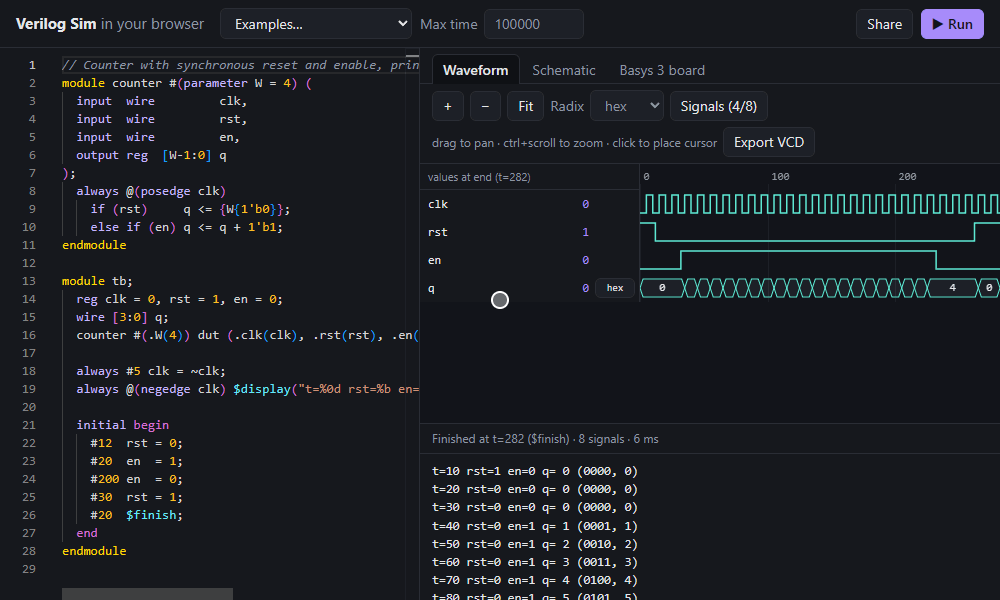

# Verilog Sim

A Verilog simulator and waveform viewer that runs entirely in the browser.
Write a design, press **Run**, and inspect the console output and waveforms —
no install, no server. Its output is checked byte-for-byte against
[Icarus Verilog](https://steveicarus.github.io/iverilog/) in CI.

**[Try it live →](https://krishteli.github.io/verilog-sim/)**



## Features

- **Editor**: Monaco with Verilog highlighting, inline error squiggles, Ctrl+Enter to run.
- **Simulator**: event-driven, with proper nonblocking-assignment semantics,
  `#` delays, `@(posedge/negedge ...)`, `@(*)`, `$display`/`$write`/`$strobe`/
  `$monitor`/`$finish`, module hierarchy and parameters.
- **Waveform viewer**: canvas-rendered, zoom/pan, cursor, per-signal radix,
  signal picker, **VCD export** for GTKWave/Surfer.
- **Schematic**: an RTL block diagram of each module, laid out with ELK —
  inputs on the left, outputs on the right, one box per `always`/`assign`/
  instance. Click an instance to open it, click a block to jump to its code,
  hover a wire to highlight the whole net.
- **Virtual Basys 3 board**: run your design on a simulated Digilent Basys 3 —
  flip the 16 switches, hold the 5 push buttons, watch the LEDs and the
  multiplexed 4-digit 7-segment display. Ports are matched by the same names
  as the board's `.xdc`, so the same file goes to a real board unchanged.
- **Shareable links**: the code is compressed into the URL; no backend.
- **Examples**: counter, FSM, ALU, ripple-carry adder, NBA vs blocking, and a
  **Basys 3 board demo** with a constraints file and a [real-board guide](boards/basys3/README.md).

## Architecture

```
source ─► lexer ─► parser ─► AST ─► elaborator ─► netlist ─► simulator ─► waves + output
          tokens   recursive         flatten        flat       event-driven     │
                   descent           hierarchy,     signals,   generators       ├─► waveform canvas
                                     size exprs     processes                   └─► VCD
```

| Stage | Where | Key idea |
| --- | --- | --- |
| Lexer | `src/core/lexer` | Maximal munch; numbers as `bigint` so >53-bit vectors stay exact. |
| Parser | `src/core/parser` | Hand-written recursive descent; precedence climbing for expressions; `<=` disambiguated by a restricted lvalue parser. |
| Elaborator | `src/core/elab` | Flattens instances into one netlist; resolves names; applies Verilog's context-/self-determined expression sizing once, up front. Ports become continuous assignments. |
| Evaluator | `src/core/eval.ts` | Expressions compiled once into closures instead of tree-walked each time. |
| Simulator | `src/core/sim` | Only re-evaluates what an input change affects. Active → inactive → NBA → postponed regions per time step. Each `always`/`initial` block is a JS generator that `yield`s at `#delay` / `@event`. |
| Schematic | `src/core/schematic`, `src/ui/Schematic.tsx` | Selects one instance from the flat netlist and connects drivers to readers; port-connection assignments become wires into instance pins again. ELK's layered (Sugiyama) layout places it; rendered as SVG. |
| Board | `src/core/board` | A `SimSession` lets the board act as the testbench: it toggles `clk`, pokes switch/button inputs, and samples outputs every cycle. Brightness = fraction of cycles a light was on, so digit multiplexing and PWM dimming look like the real thing. |
| UI | `src/ui` | React; simulation runs in a Web Worker so the page never freezes (Stop = terminate the worker). The board runs in its own worker, time-sliced into ~16 ms frames. |

`src/core` has no DOM or React imports: it runs in Node for tests, in CI, and in the worker.

### Verilog subset

Modules with ANSI ports (incl. leading-comma style); `wire`/`reg`/`integer`
with widths and `signed`; `parameter`/`localparam` and `#(...)` overrides;
`assign`; `always` with `@(*)`, edge or level lists, or `#` delays; `initial`;
`begin`/`end`, `if`/`else`, `case`/`default`; blocking and nonblocking
assignment; all common operators incl. reductions, shifts, `**`, `?:`, bit/part
selects (`a[i +: 4]`), concatenation and replication; module instantiation by
name or position; read-only hierarchical references (`dut.count`).

Not yet: `for`/`while`/`repeat`/`forever`, functions/tasks, `generate`,
memories (`reg [7:0] mem [0:255]`), `casez`/`casex`, and X/Z values.

### Differences from Icarus Verilog

The simulator is **2-state** (0/1). Signals that Icarus would show as `x`
start at 0 here. To stay compatible in practice, a signal is tracked as
"unknown" until its first write, so that write still produces the X→value
events a 4-state simulator would (it wakes `@(sig)`; X→1 is a posedge).
Divide by zero gives 0 instead of `x`. `` `timescale `` is ignored: delays and
`$time` are in unitless ticks. Each difference that surfaced was verified
against Icarus and is pinned by a golden test.

## Development

```bash
npm install
npm run dev          # http://localhost:5173
npm test             # unit tests + golden comparison against Icarus output
npm run typecheck
npm run build        # static site in dist/
```

### Golden tests

`tests/golden/*.v` (or `*.files` for multi-file designs) are simulated by both
this project and Icarus. `scripts/update-golden.sh` regenerates the
`.expected` files with `iverilog`; `npm test` compares our output against them.
CI also re-runs the script with a fresh `iverilog` and fails if anything changed.

## Deployment

The build is a static site with relative asset paths, so it works on GitHub
Pages or Vercel unchanged. `.github/workflows/deploy.yml` publishes to Pages
on every push to `main` (enable it once: *Settings → Pages → Source: GitHub Actions*).
For Vercel, import the repo and use the defaults (build `npm run build`, output `dist`).

## Roadmap

- [x] Lexer and parser with unit tests
- [x] Elaboration + combinational logic
- [x] Event-driven simulation (clocked logic, NBA, delays)
- [x] Waveform viewer (zoom/pan, radix, VCD export)
- [x] Schematic view from the netlist (elkjs)
- [x] Examples, shareable URLs, deployment config, demo GIF (`npm run record-demo` re-records it)
- [x] Stretch: virtual Basys 3 panel (switches, buttons, LEDs, 7-segment)

### Virtual board notes

The real board's clock is 100 MHz; JavaScript simulates a few hundred
thousand cycles per second, so the panel runs the clock at a rate you choose
(100 kHz by default) and lets you override the top module's parameters to
shrink time constants — the same trick a testbench uses. The demo example
presets `TICK=100_000`, so it still counts once per second.
